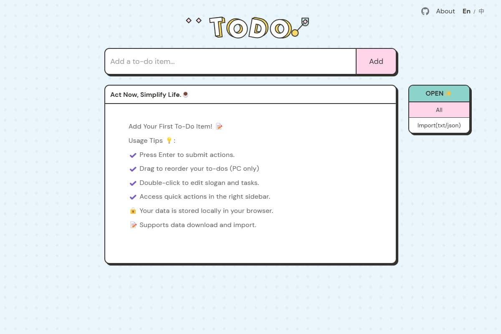
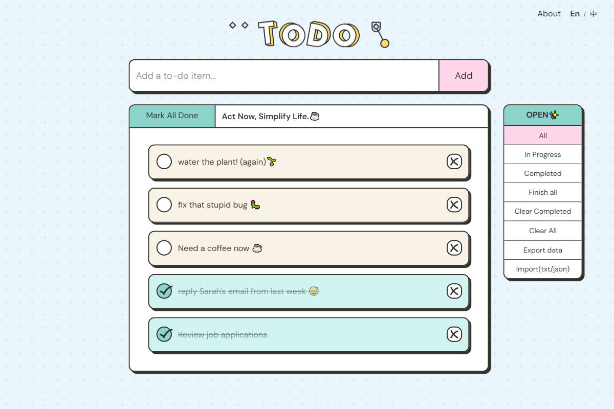

# Simple Todo List

[https://duck-todo.netlify.app/](https://duck-todo.netlify.app/)

***Static files, download and open locally. Default is index.html (English)***

No sign up or login required. This is a local-only todo list app - your data stays in your browser and is never sent to any server.

Using a Todo List is very common in work. There are many Todo List products on the market, whether they are desktop applications or mobile apps/mini-programs. These products often consider diverse user needs, developing various features, including some social attributes, and even containing advertisements.

My personal product requirements are: basic, clean and simple, no need for extra features, and visually satisfactory.

So I decided to try writing my own Todo List application, which can not only meet my different daily ideas and needs, but also allow me to decide the visual style, no matter how quirky, as long as I like it.

## Author

- GitHub: [harshitsinghai77](https://github.com/harshitsinghai77)
- LinkedIn: [harshitsinghai](https://www.linkedin.com/in/harshitsinghai/)
- Blog: [fictionally-irrelevant](https://fictionally-irrelevant.vercel.app/)

---

## License

This project is licensed under the MIT license. See the [LICENSE](./LICENSE) file for more info.
